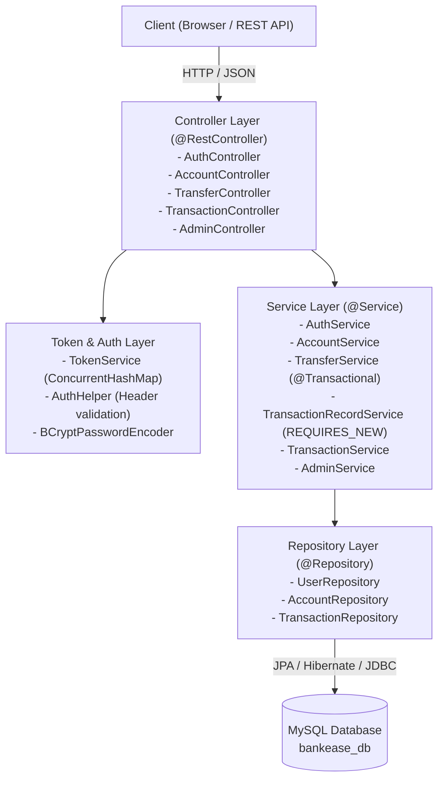

# BankEase: NextGen Net Banking 🏦

> **College Solo Project** (Collaborated with **HCL**)  
> **Tech Stack:** Angular, TypeScript, Java 25, Spring Boot 4.1.2, Spring Data JPA, MySQL 8+, Jakarta Validation, BCrypt.

---

## 📖 1. Project Overview

**BankEase** is a modern, responsive, and robust Net Banking Minimum Viable Product (MVP) engineered to simulate real-world core banking operations. It implements strict layered architecture, transactional integrity for fund transfers, cryptographic password hashing, audit trails, and role-based access for Customers and Administrators.

### Key Highlights
- **Layered Architecture:** Controller $\rightarrow$ Service $\rightarrow$ Repository $\rightarrow$ Database.
- **Enterprise Security (JWT + Spring Security):** HMAC-SHA256 signed JSON Web Tokens, `JwtAuthenticationFilter`, `SecurityFilterChain`, and salted BCrypt encryption.
- **Transactional Fund Transfers:** Guaranteed ACID compliance with `@Transactional`, daily limit compliance, and high-value 2FA OTP verification.
- **Bill Pay & Utilities:** Registered payees, instant payments (Electricity, Water, Broadband, Mobile), and scheduled auto-pay.
- **Loan Module & EMI Calculator:** Real-time EMI mathematical engine ($E = \frac{P \cdot r \cdot (1+r)^n}{(1+r)^n - 1}$), customer loan applications, and Administrator approval/disbursement workflow.
- **Wealth & Investments:** Fixed Deposit (FD) compound interest simulator, Recurring Deposits (RD), and Mutual Funds portfolio management.
- **Compliance & Risk Controls:** 3-strike account lockout defense, daily transfer limit enforcement, KYC status verification, and real-time security audit trails.
- **Angular Single-Page App (SPA):** Modern Angular frontend (`frontend/`) featuring standalone components, Angular Signals, functional HTTP Bearer token interceptor, and responsive UI. The production build is integrated directly into Spring Boot (`src/main/resources/static/`).
- **Automatic Data Seeding:** Ready-to-demo data created on first boot (`admin`, `rahul`, `priya`).

---

## 🏛️ 2. Architectural Design



### Explaining the `@Transactional` Transfer Logic
In banking, moving money between accounts consists of two distinct database mutations:
1. **Debit:** Deduct ₹ $X$ from Account A.
2. **Credit:** Add ₹ $X$ to Account B.

If a server failure, database crash, or network timeout occurs after Step 1 but before Step 2, money would disappear from the system. 

#### How `@Transactional` Prevents This:
- **Atomicity:** Spring wraps both database operations in a single database transaction. Either both the debit and the credit succeed and commit together, or if an unexpected error occurs, the entire operation is rolled back and no balances change.
- **Consistency:** Total money invariant in the system is preserved ($Balance_{sender} + Balance_{receiver} = Constant$).
- **Isolation:** Other transactions cannot view partial debit states.
- **Durability:** Once committed, balance updates persist permanently in MySQL.

#### Recording Failed Transfer Attempts (`Propagation.REQUIRES_NEW`)
The project requirement specifies: *"Save a Transaction record for every attempt."*

If validation fails (such as **Insufficient Balance** or **Destination Account Does Not Exist**), throwing an exception inside a standard `@Transactional` method would roll back everything, including the attempt record.

To solve this cleanly, BankEase uses **`TransactionRecordService`** with `@Transactional(propagation = Propagation.REQUIRES_NEW)`:
```java
@Transactional(propagation = Propagation.REQUIRES_NEW)
public Transaction record(Account fromAccount, Account toAccount,
                          BigDecimal amount, TransactionType type,
                          TransactionStatus status, String description) {
    Transaction tx = new Transaction(fromAccount, toAccount, amount, type, status, description);
    return transactionRepository.save(tx);
}
```
`REQUIRES_NEW` suspends any active transaction and starts a **brand-new database connection & transaction** specifically for the audit record. Even when the transfer is subsequently rejected or an exception is thrown, the `FAILED` transaction record is safely committed in MySQL for compliance!

---

## 🔑 3. Pre-Seeded Accounts (CommandLineRunner)

When you first launch BankEase, the `DataSeeder` automatically generates three testing accounts:

| User | Email | Password | Role | Account Number | Opening Balance |
|---|---|---|---|---|---|
| **System Admin** | `admin@bankease.com` | `admin123` | `ADMIN` | `1009999999` | ₹ 50,000.00 |
| **Rahul Sharma** | `rahul@bankease.com` | `rahul123` | `CUSTOMER` | `1001001001` | ₹ 10,000.00 |
| **Priya Patel** | `priya@bankease.com` | `priya123` | `CUSTOMER` | `1002002002` | ₹ 10,000.00 |

*(The web interface features 1-click quick autofill buttons for these credentials).*

---

## 🚀 4. How to Run the Project

### Prerequisites
1. **Java 25** (installed and configured).
2. **MySQL Server 8+** running on `localhost:3306`.

### Step 1: Create Database in MySQL
Open your MySQL CLI or MySQL Workbench and run:
```sql
CREATE DATABASE IF NOT EXISTS bankease_db;
```

### Step 2: Configure Password
Open `src/main/resources/application.properties` and update your MySQL root password:
```properties
spring.datasource.password=YOUR_ACTUAL_PASSWORD
```

### Step 3: Run the Application
You can run the application directly using the included Maven Wrapper:

**On Windows (PowerShell / Command Prompt):**
```powershell
.\mvnw.cmd spring-boot:run
```

*(Note: The Maven Wrapper has been configured with an automatic fallback to Java 25).*

Or build and run the packaged JAR:
```powershell
.\mvnw.cmd clean package
java -jar target/bankease-backend-0.0.1-SNAPSHOT.jar
```

### Step 4: Access the Frontend

You have two convenient ways to access the Angular application:

#### Option A: Directly from Spring Boot (Bundled Production Build)
Open your browser and navigate to:
```
http://localhost:8080/
```
*(Spring Boot automatically serves the compiled Angular standalone bundle from `src/main/resources/static/`).*

#### Option B: Dedicated Angular Dev Server (with Hot Reloading)
In a separate terminal:
```bash
cd frontend
npm start
```
Then visit:
```
http://localhost:4200/
```
*(The Angular dev server connects to the Spring Boot REST backend on port 8080).*

---

## 📡 5. Complete REST API Catalog

All endpoints return uniform JSON responses wrapped in `ApiResponse<T>` or `ErrorResponse`.

### A. Authentication APIs (`/api/auth`)

#### 1. Register New Customer
- **Endpoint:** `POST /api/auth/register`
- **Request Body:**
```json
{
  "fullName": "Amit Verma",
  "email": "amit@example.com",
  "password": "Password@123"
}
```
- **Response (201 Created):**
```json
{
  "success": true,
  "message": "Registration successful! Default SAVINGS account opened with ₹10,000 demo credit.",
  "data": {
    "token": "7a35c24e-b35a-4cb7-a508-8e6fa39b4b02",
    "userId": 4,
    "fullName": "Amit Verma",
    "email": "amit@example.com",
    "role": "CUSTOMER",
    "accounts": [
      {
        "id": 4,
        "accountNumber": "1005839201",
        "accountType": "SAVINGS",
        "balance": 10000.00,
        "ownerName": "Amit Verma",
        "ownerEmail": "amit@example.com",
        "createdAt": "2026-10-29T15:30:00"
      }
    ]
  },
  "timestamp": "2026-10-29T15:30:00"
}
```

#### 2. User Login
- **Endpoint:** `POST /api/auth/login`
- **Request Body:**
```json
{
  "email": "rahul@bankease.com",
  "password": "rahul123"
}
```
- **Response (200 OK):**
```json
{
  "success": true,
  "message": "Login successful.",
  "data": {
    "token": "d135ea29-37e4-4a43-982d-45f8cb3392d7",
    "userId": 2,
    "fullName": "Rahul Sharma",
    "email": "rahul@bankease.com",
    "role": "CUSTOMER",
    "accounts": [...]
  }
}
```

#### 3. Verify Session (`/api/auth/me`)
- **Endpoint:** `GET /api/auth/me`
- **Header:** `Authorization: Bearer <token>`

#### 4. Logout
- **Endpoint:** `POST /api/auth/logout`
- **Header:** `Authorization: Bearer <token>`

---

### B. Account APIs (`/api/accounts`)

#### 1. Get My Accounts & Balances
- **Endpoint:** `GET /api/accounts/my-accounts`
- **Header:** `Authorization: Bearer <token>`
- **Response (200 OK):**
```json
{
  "success": true,
  "message": "Accounts fetched successfully.",
  "data": [
    {
      "id": 2,
      "accountNumber": "1001001001",
      "accountType": "SAVINGS",
      "balance": 10000.00,
      "ownerName": "Rahul Sharma",
      "ownerEmail": "rahul@bankease.com",
      "createdAt": "2026-10-29T15:00:00"
    }
  ]
}
```

#### 2. Get Account by Number
- **Endpoint:** `GET /api/accounts/{accountNumber}`
- **Header:** `Authorization: Bearer <token>`

---

### C. Fund Transfer API (`/api/transfers`)

#### 1. Transfer Funds
- **Endpoint:** `POST /api/transfers`
- **Header:** `Authorization: Bearer <token>`
- **Request Body:**
```json
{
  "fromAccountNumber": "1001001001",
  "toAccountNumber": "1002002002",
  "amount": 1500.00,
  "description": "Project milestone share"
}
```
- **Response (200 OK):**
```json
{
  "success": true,
  "message": "Transfer completed successfully.",
  "data": {
    "transactionId": 4,
    "status": "SUCCESS",
    "message": "Transfer completed successfully.",
    "fromAccountNumber": "1001001001",
    "toAccountNumber": "1002002002",
    "amount": 1500.00,
    "remainingBalance": 8500.00,
    "timestamp": "2026-10-29T15:32:00"
  }
}
```

- **Example Error Response (Insufficient Balance - 400 Bad Request):**
```json
{
  "timestamp": "2026-10-29T15:33:00",
  "status": 400,
  "error": "Insufficient Balance",
  "message": "Insufficient funds. Available balance: ₹8500.00",
  "path": "/api/transfers"
}
```
*(Note: A transaction with status `FAILED` is automatically saved in MySQL).*

---

### D. Transaction History API (`/api/transactions`)

#### 1. Get Account Statement
- **Endpoint:** `GET /api/transactions/account/{accountNumber}`
- **Header:** `Authorization: Bearer <token>`
- **Response (200 OK, Newest First):**
```json
{
  "success": true,
  "message": "Transaction history retrieved successfully.",
  "data": [
    {
      "id": 4,
      "fromAccountNumber": "1001001001",
      "fromOwnerName": "Rahul Sharma",
      "toAccountNumber": "1002002002",
      "toOwnerName": "Priya Patel",
      "amount": 1500.00,
      "type": "TRANSFER",
      "status": "SUCCESS",
      "description": "Project milestone share",
      "createdAt": "2026-10-29T15:32:00"
    },
    {
      "id": 2,
      "fromAccountNumber": "SYSTEM DEPOSIT",
      "fromOwnerName": "BankEase System",
      "toAccountNumber": "1001001001",
      "toOwnerName": "Rahul Sharma",
      "amount": 10000.00,
      "type": "DEPOSIT",
      "status": "SUCCESS",
      "description": "Welcome bonus / demo opening credit",
      "createdAt": "2026-10-29T15:00:00"
    }
  ]
}
```

---

### E. Admin Management APIs (`/api/admin`)
*(Protected: Requires `Role.ADMIN`)*

| Method | Endpoint | Description |
|---|---|---|
| `GET` | `/api/admin/users` | List all users with linked accounts & compliance status |
| `GET` | `/api/admin/accounts` | List all system bank accounts and balances |
| `GET` | `/api/admin/transactions` | Full audit log of all system transactions |

---

### F. Bill Pay & Utility Services (`/api/bills`)
*(Protected: Requires `Role.CUSTOMER` or `Role.ADMIN`)*

| Method | Endpoint | Description |
|---|---|---|
| `GET` | `/api/bills/payees` | List registered utility payees (Electricity, Water, DTH, etc.) |
| `POST` | `/api/bills/payees` | Register a new utility payee |
| `POST` | `/api/bills/pay` | Instant bill payment debited directly from bank account |
| `POST` | `/api/bills/schedule` | Schedule a future or recurring utility bill payment |
| `GET` | `/api/bills/history` | View complete bill payment history and statuses |

---

### G. Loan & EMI Engine (`/api/loans`)
*(Protected)*

| Method | Endpoint | Description |
|---|---|---|
| `GET` | `/api/loans/calculate-emi` | Calculate exact EMI using mathematical formula ($E = \frac{P \cdot r \cdot (1+r)^n}{(1+r)^n - 1}$) |
| `POST` | `/api/loans/apply` | Apply for Personal, Home, Education, or Vehicle loan |
| `GET` | `/api/loans/my-loans` | View customer active and historical loans |
| `GET` | `/api/loans/all` | Admin: review all customer loan applications |
| `POST` | `/api/loans/{id}/approve` | Admin: approve loan & automatically disburse funds to account |
| `POST` | `/api/loans/{id}/reject` | Admin: reject loan application with remarks |

---

### H. Wealth & Investments Simulator (`/api/investments`)
*(Protected)*

| Method | Endpoint | Description |
|---|---|---|
| `GET` | `/api/investments/calculate-fd` | Simulate FD returns with quarterly compounding |
| `POST` | `/api/investments` | Book a Fixed Deposit, Recurring Deposit, or Mutual Fund |
| `GET` | `/api/investments/my-investments`| Portfolio view of all active and matured investments |
| `POST` | `/api/investments/{id}/close` | Prematurely liquidate or redeem investment with proceeds credited |

---

### I. Compliance, KYC & Risk Engine (`/api/compliance`)

| Method | Endpoint | Description |
|---|---|---|
| `POST` | `/api/compliance/send-otp` | Generate time-sensitive 6-digit OTP for 2FA transfers ($\ge$ ₹25,000) |
| `POST` | `/api/compliance/verify-otp` | Validate 2FA OTP |
| `GET` | `/api/compliance/kyc-status` | Check customer KYC verification tier |
| `POST` | `/api/compliance/update-kyc` | Update KYC status (PENDING, VERIFIED, REJECTED) |
| `POST` | `/api/compliance/update-limit` | Modify daily transaction compliance limit |
| `GET` | `/api/compliance/audit-logs` | Admin: access real-time security audit trails |
| `POST` | `/api/compliance/unlock-user/{id}` | Admin: unlock accounts frozen after 3 failed login attempts |

---

## 🌟 6. Enterprise Features & Viva Highlights

During your evaluation or project viva with faculty and HCL collaborators, you can highlight how BankEase goes beyond a typical student project:
1. **Stateless JWT Security Architecture:** Modern stateless authentication using Spring Security 6 `SecurityFilterChain` with custom `JwtAuthenticationFilter` verifying HMAC-SHA256 tokens on every protected request.
2. **Three-Strike Brute Force Protection:** Automatic account lockout triggered upon 3 consecutive failed login attempts, recorded in audit logs with administrative unlock capability.
3. **High-Value 2FA Step-Up Authentication:** Transactions exceeding ₹25,000 strictly enforce simulated 6-digit one-time password (OTP) verification before debit execution.
4. **Loan Lifecycle & Disbursement:** Integrated financial math for EMI computation and an end-to-end admin approval workflow that automatically credits loan amounts to the borrower's account via atomic database transactions.
5. **Wealth Management & Compound Interest:** Accurate quarterly compounding Fixed Deposit simulator ($A = P(1 + r/4)^{4t}$) and portfolio tracking.
6. **Immutable Security Audit Trail:** Every sensitive action (logins, lockouts, limit changes, loans, transfers) is committed to an append-only audit log table with client IP tracking.

---
Developed as a solo academic project in collaboration with **HCL**.

