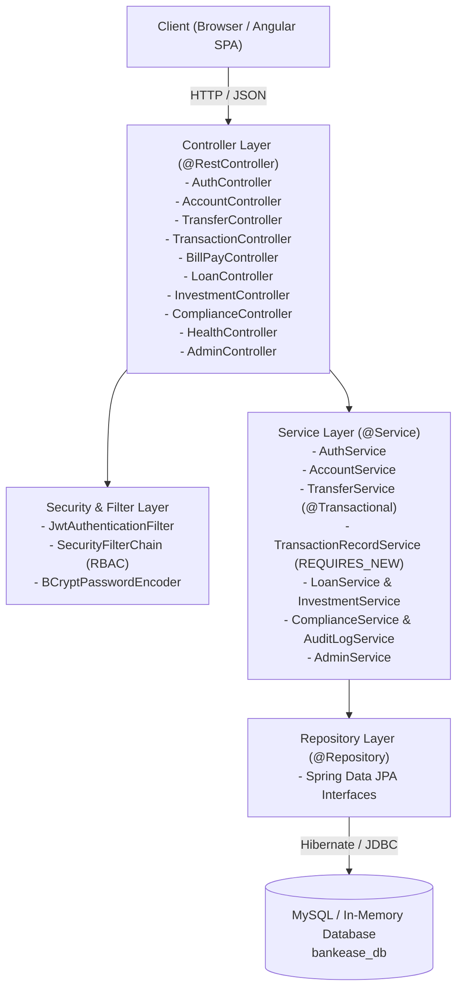

# BankEase — NextGen Digital Banking Suite 🏦

[](https://bankease-cmio.onrender.com/)
[](https://spring.io/projects/spring-boot)
[](https://openjdk.org/)
[](https://angular.dev/)
[](LICENSE)

A modern, robust, and secure full-stack enterprise digital core banking platform engineered with **Spring Boot 4**, **Java 25**, **Angular 22**, and **MySQL 8+**.

🌐 **Live Cloud Demo:** [https://bankease-cmio.onrender.com/](https://bankease-cmio.onrender.com/)  
⚡ **API Health Probe:** [https://bankease-cmio.onrender.com/api/health](https://bankease-cmio.onrender.com/api/health)

---

## 🔑 Demo Test Credentials

To test the live portal immediately, use the pre-configured accounts (or click the 1-click quick-fill buttons in the login screen):

| Role | Email | Password | Account Number | Opening Balance | KYC Status |
| :--- | :--- | :--- | :--- | :--- | :--- |
| **System Admin** | `admin@bankease.com` | `admin123` | `1009999999` | ₹ 50,000.00 | `VERIFIED` |
| **Customer** | `rahul@bankease.com` | `rahul123` | `1001001001` | ₹ 10,000.00 | `PENDING` |
| **Customer** | `priya@bankease.com` | `priya123` | `1002002002` | ₹ 10,000.00 | `PENDING` |

---

## 📌 1. Platform Overview

**BankEase** provides an end-to-end digital core banking experience designed around real-world financial workflows, strict transactional consistency, regulatory risk controls, and modern security architecture.

### Core Modules & Capabilities

- **Account Management:** Multi-tier accounts (Savings and Current) with real-time balance tracking and comprehensive statement generation.
- **Transactional Fund Transfers:** ACID-guaranteed fund transfers with `@Transactional` atomicity, daily limits enforcement, and isolated audit logging via `Propagation.REQUIRES_NEW`.
- **Enterprise Security:** Spring Security 6 and stateless HMAC-SHA256 JWT authentication, salted BCrypt password hashing, and brute-force protection with automatic 3-strike account lockout.
- **Compliance & Risk Control:** Customer KYC tier verification, PII document number masking (`XXXX-XXXX-1234`), 2FA OTP verification for high-value transactions ($\ge$ ₹25,000), and automated startup data repair for legacy compliance records.
- **Bill Pay & Utilities:** Instant bill settlement (Electricity, Water, Broadband, Mobile) with payee registry and scheduled automated payments.
- **Loan & EMI Calculator:** Real-time EMI mathematical engine based on exact amortization formulas ($E = \frac{P \cdot r \cdot (1+r)^n}{(1+r)^n - 1}$) using 16-digit precision `BigDecimal`, coupled with administrative approval and automated disbursement.
- **Wealth & Investments:** Compound interest simulation engine for Fixed Deposits (FD), Recurring Deposits (RD), and Mutual Funds with premature redemption capabilities.
- **Modern Angular Frontend:** Standalone component architecture, Angular Signals, reactive forms, functional HTTP Bearer interceptors, and a signature Earth-tone palette:
  - **Walnut Brown (`#5A3E2B`):** Primary branding, module navigation bar, headers, and primary actions.
  - **Sage Green (`#87A96B`):** Account balances, positive credit movements, and verified compliance status.
  - **Amber Glow (`#D5851F`):** Active navigation indicators, 2FA OTP security alerts, and loan EMI calculations.

---

## 🏛️ 2. System Architecture



### Transactional Atomicity & Attempt Logging

1. **Atomic Transfers:** Balances are transferred within an atomic transaction. A failure during either the debit or credit phase triggers a complete rollback to guarantee system balance invariants.
2. **Independent Audit Trails:** Transaction attempts (both `SUCCESS` and `FAILED`) are captured using `Propagation.REQUIRES_NEW` via `TransactionRecordService`. Even when transfers are rejected due to insufficient funds or exceeded daily limits, the compliance record is permanently preserved in the database.

---

## 🛠️ 3. Technology Stack

| Layer | Technology | Details |
| :--- | :--- | :--- |
| **Backend Framework** | Spring Boot 4.1.2 | Spring Web MVC, Spring Data JPA, Spring Security 6, Jakarta Validation |
| **Language** | Java 25 | Modern LTS features, Records, Pattern Matching, Strict Type Safety |
| **Database** | MySQL 8+ / H2 | InnoDb engine with foreign key constraints, indexing, and ACID compliance |
| **Authentication** | JWT (jjwt 0.12.6) | 256-bit HMAC-SHA256 stateless session tokens |
| **Cryptography** | BCrypt | Salted password hashing via `spring-security-crypto` |
| **Frontend Framework**| Angular 22 | Standalone Components, Angular Signals, TypeScript, Modern CSS Grid |
| **Containerization** | Docker | Multi-stage Dockerfile (Node 24 + Temurin 25 JRE), Docker Compose |
| **Hosting & CI/CD** | Render & GitHub Actions | Automated build, unit testing, and continuous deployment |

---

## 🚀 4. Getting Started (Local Development)

### Prerequisites

1. **Java 25 SDK** installed and configured (`JAVA_HOME`).
2. **MySQL Server 8+** running on `localhost:3306` (or Docker).
3. **Node.js (v24+) & npm** (optional, for standalone frontend development).

### Step 1: Initialize Database

Create the target database in MySQL:

```sql
CREATE DATABASE IF NOT EXISTS bankease_db;
```

### Step 2: Configure Environment Variables

BankEase enforces zero-trust security. Secrets and credentials are externalized and configured through environment variables:

#### On Windows (PowerShell):
```powershell
# 1. Cryptographically secure 256-bit secret key for signing JWTs (minimum 32 characters)
$env:JWT_SECRET="YourSecureSecretKeyMinimum32CharactersLengthRequired123!"

# 2. MySQL root database password
$env:DB_PASSWORD="YourMySQLPassword"

# 3. Optional Settings
$env:OTP_DEMO_MODE="false"   # Set to "true" to expose OTP in API payload for test environments
$env:SEED_ENABLED="true"     # Set to "false" in production environments
```

#### On Linux / macOS (Bash / Zsh):
```bash
export JWT_SECRET="YourSecureSecretKeyMinimum32CharactersLengthRequired123!"
export DB_PASSWORD="YourMySQLPassword"
export OTP_DEMO_MODE="false"
export SEED_ENABLED="true"
```

### Step 3: Run the Test Suite

Execute the automated test suite (uses fast in-memory H2 database; does not require an active MySQL instance):

```powershell
.\mvnw.cmd test
```

### Step 4: Launch the Application

#### Option A: Run with Maven Wrapper
```powershell
.\mvnw.cmd spring-boot:run
```

#### Option B: Run with Docker Compose (Full-Stack + MySQL)
```bash
docker compose up -d --build
```

Once started, the complete digital banking interface is served at:
👉 **[http://localhost:8080/](http://localhost:8080/)**

*(Spring Boot automatically bundles and serves the production-compiled Angular application from `src/main/resources/static/`).*

> 📖 **Production Deployment Guide:** For detailed guides on deploying via Docker, Render, Railway, or Linux VPS with systemd and Nginx, see [**`DEPLOYMENT.md`**](DEPLOYMENT.md).

---

## 📡 5. REST API Endpoints Summary

All responses follow a uniform structure: `{ "success": boolean, "message": string, "data": T, "timestamp": string }`.

| Category | Method | Endpoint | Access Level | Description |
| :--- | :--- | :--- | :--- | :--- |
| **System** | `GET` | `/api/health` | Public | Unauthenticated health check probe for load balancers |
| **Auth** | `POST` | `/api/auth/register` | Public | Register new user & auto-provision savings account |
| **Auth** | `POST` | `/api/auth/login` | Public | Authenticate user & issue signed JWT |
| **Auth** | `GET` | `/api/auth/me` | Authenticated | Retrieve authenticated session details |
| **Accounts** | `GET` | `/api/accounts/my-accounts` | Authenticated | Fetch active accounts and balances |
| **Accounts** | `GET` | `/api/accounts/{accountNumber}` | Authenticated | Fetch account details by account number |
| **Transfers** | `POST` | `/api/transfers` | Authenticated | Execute atomic fund transfer (2FA OTP for $\ge$ ₹25,000) |
| **Transactions**| `GET` | `/api/transactions/account/{number}`| Authenticated | Retrieve reverse-chronological account statement |
| **Bill Pay** | `GET` | `/api/bills/payees` | Authenticated | List registered utility payees |
| **Bill Pay** | `POST` | `/api/bills/pay` | Authenticated | Execute instant utility bill payment |
| **Bill Pay** | `POST` | `/api/bills/schedule` | Authenticated | Schedule future automated bill payment |
| **Loans** | `GET` | `/api/loans/calculate-emi` | Public / Auth | Calculate exact loan EMI using amortization formula |
| **Loans** | `POST` | `/api/loans/apply` | Authenticated | Submit formal loan application |
| **Loans** | `POST` | `/api/loans/{id}/approve` | Admin Only | Approve loan and disburse funds to account |
| **Investments** | `GET` | `/api/investments/calculate-fd` | Public / Auth | Simulate compound returns for Fixed Deposits |
| **Investments** | `POST` | `/api/investments` | Authenticated | Book new FD, RD, or Mutual Fund investment |
| **Investments** | `POST` | `/api/investments/{id}/close` | Authenticated | Liquidate investment and credit proceeds to account |
| **Compliance** | `POST` | `/api/compliance/send-otp` | Authenticated | Dispatch 6-digit session-bound transfer OTP |
| **Compliance** | `POST` | `/api/compliance/update-limit`| Authenticated | Update user daily transfer limit |
| **Compliance** | `GET` | `/api/compliance/kyc-status` | Authenticated | Retrieve KYC verification status |
| **Compliance** | `GET` | `/api/compliance/audit-logs` | Admin Only | View system-wide security and compliance logs |
| **Admin** | `GET` | `/api/admin/users` | Admin Only | List all registered users and compliance statuses |
| **Admin** | `GET` | `/api/admin/accounts` | Admin Only | System-wide account liquidity and balances overview |
| **Admin** | `GET` | `/api/admin/transactions` | Admin Only | Complete audit trail of all transactions |

---

## 🔒 6. Security & Production Standards

1. **Role-Based Access Control (RBAC):**
   - Public access is strictly restricted to login, registration, and calculator simulation routes.
   - All operational endpoints mandate authentication via `JwtAuthenticationFilter`.
   - Administrative routes (`/api/admin/**`) strictly enforce `hasRole('ADMIN')`.
2. **Stateless JWT Lifecycle:**
   - Cryptographic signing verified via HMAC-SHA256 (`HS512`).
   - Secret key externalized via `JWT_SECRET` with startup fail-fast validation (minimum 32 characters).
3. **Data Protection & PII Masking:**
   - Identity documents (Aadhaar / PAN) are masked (`XXXX-XXXX-1234`) prior to entering audit logs.
   - Database credentials and API tokens are never checked into version control.
4. **Brute-Force Attack Mitigation:**
   - Accounts are automatically frozen upon 3 consecutive failed login attempts, requiring administrative unlock.
5. **High-Precision Financial Math:**
   - All monetary amounts, interest calculations, and EMI engines utilize `BigDecimal` with explicit scale and rounding mode (`RoundingMode.HALF_EVEN`), preventing IEEE 754 floating-point inaccuracies.
6. **Automated Test Coverage:**
   - Comprehensive suite of 41 unit and integration tests covering security authorization, transfer transactional atomicity, EMI mathematical formulas, and legacy compliance data repairs.

---

## 📄 License

This project is licensed under the [MIT License](LICENSE).
